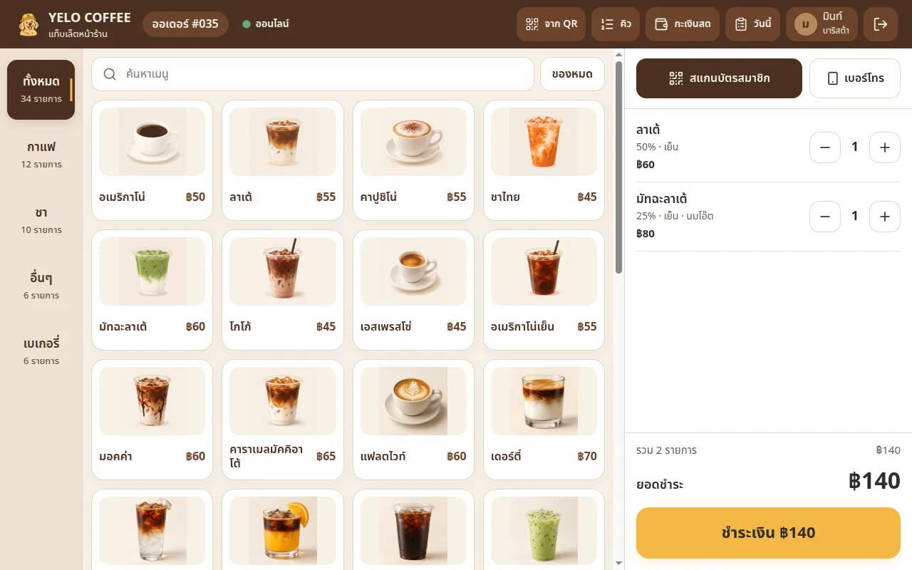
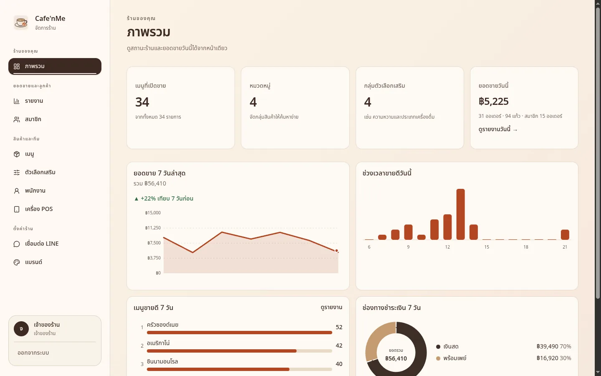
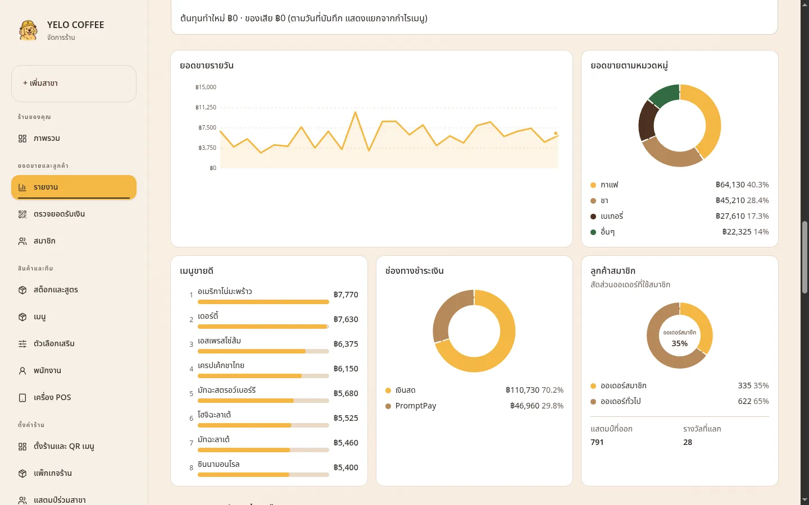
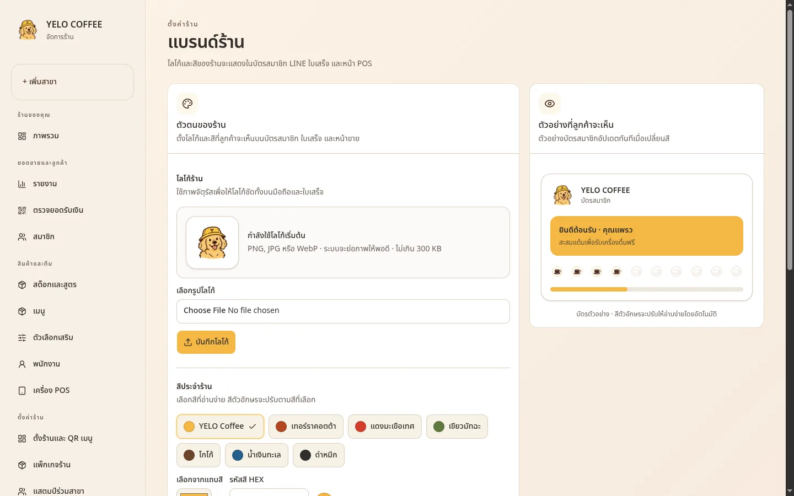
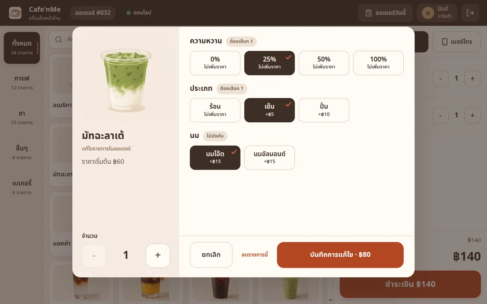
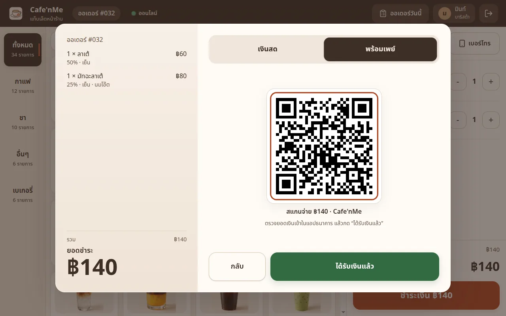
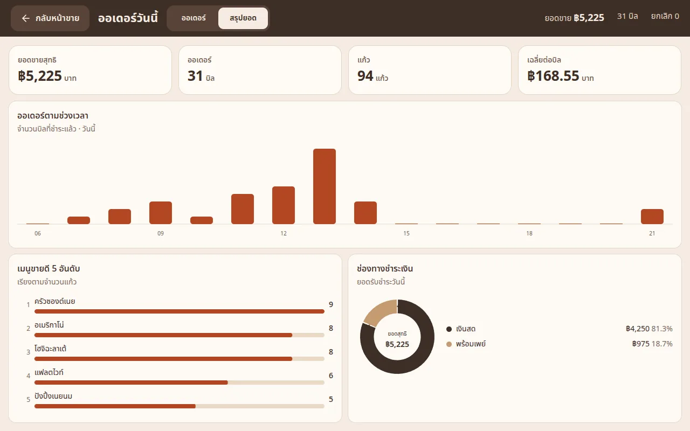
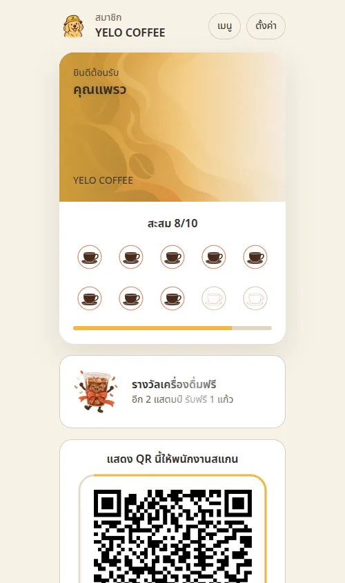
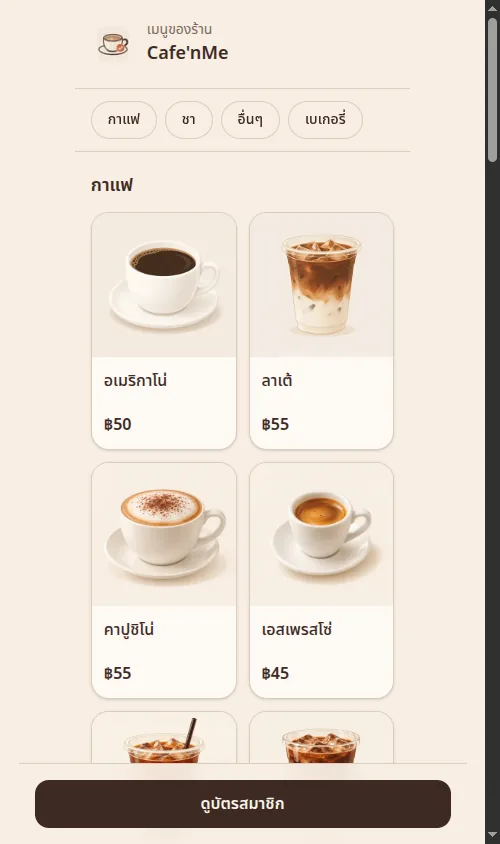

# Cafe'nMe

A point of sale for Thai cafés with a LINE stamp-card membership. Staff sell on a tablet POS, owners manage the shop and see sales charts in a web admin, and customers collect stamps and redeem free drinks from a LINE Official Account (rich menu + LIFF member card).

The product scope, decisions and architecture are in [PLAN.md](./PLAN.md).

The applications live in separate workspace packages:

```text
frontend/  Next.js app, browser assets, and frontend tests
backend/   NestJS API, database schema/migrations, seed scripts, and Supabase config
docs/      Product and engineering documentation
```

<p align="center"></p>

## Features

**POS (tablet, touch)**
- Pair a tablet with a 6-digit code or QR, staff sign in with a PIN.
- Photo menu with search and categories, add-ons (sweetness, hot/iced, milk, extra shot), editable cart lines that survive a refresh.
- Cash with smart quick amounts, or PromptPay QR with the amount built in.
- Scan a member's LINE QR or search by phone; stamps and free-drink rewards apply automatically.
- One-tap "sold out" toggle, today's orders, voids with a manager PIN, 58 mm receipts, and a live daily summary.

**Admin (web)**
- Setup checklist for new shops, stock menu with 30 photos, standard add-on set, bulk linking of add-ons to products.
- Dashboard and reports with animated charts (sales trend, hourly sales, categories, best sellers, payment mix, members), CSV export.
- Members, staff and roles, POS devices, LINE channel settings.
- Brand kit: shop logo and colour flow into the LINE member card, stamps, receipts and a generated LINE rich menu.

**LINE (customers)**
- Rich menu: member card, my stamps, menu, sign up, shop profile, contact.
- LIFF member card with a rotating QR, stamp progress and rewards; menu view; PDPA consent and self-service data deletion.

| Admin dashboard | Reports | Brand kit |
| --- | --- | --- |
|  |  |  |

| Add-ons | PromptPay | Daily summary |
| --- | --- | --- |
|  |  |  |

| LINE member card | LINE menu |
| --- | --- |
|  |  |

## Stack

Frontend: Next.js 16 (App Router, Cache Components) · React 19 · Tailwind CSS 4 · shadcn/ui (Base UI) · GSAP · Vitest. Backend: NestJS 12 · Postgres · Drizzle ORM · Supabase Auth · LINE Messaging API + LIFF.

## Local setup

Prerequisites: Node.js 20.9+, pnpm, Docker.

1. `pnpm install`
2. Start local Supabase: `pnpm supabase start -x realtime,storage-api,imgproxy,edge-runtime,logflare,vector,supavisor`
3. Copy `frontend/.env.example` to `frontend/.env.local` and fill it in from `pnpm supabase status` (plus `APP_SECRET`, e.g. `openssl rand -hex 32`). Backend-only deployments need `DATABASE_URL`, `APP_SECRET`, and `API_PORT` from `backend/.env.example`.
4. `pnpm db:migrate`
5. `pnpm db:seed`, then optionally `pnpm db:seed-menu` (30 photo menu items) and `pnpm db:seed-sales` (30 days of demo orders; `--reset` removes them).
6. `pnpm dev`
7. Admin: `owner@demo.test` / `password123`. POS PINs: owner `1234`, barista `1111`. With `LINE_DEV_MOCK=1` the LIFF pages work without LINE at `/liff/demo-cafe`.

## Environment variables

| Name | Purpose |
| --- | --- |
| `DATABASE_URL` | Postgres connection string used by the backend (server only). |
| `NEXT_PUBLIC_SUPABASE_URL` / `NEXT_PUBLIC_SUPABASE_ANON_KEY` | Supabase Auth for the admin login. |
| `SUPABASE_SERVICE_ROLE_KEY` | Used by the seed script only. |
| `API_BASE_URL` / `API_PORT` | Frontend's backend URL and Nest's listening port. |
| `APP_SECRET` | Signs POS sessions and member QR tokens; derives the key that encrypts LINE secrets. |
| `LINE_DEV_MOCK` | `1` only in local development. |

LINE channel IDs, secret and access token are entered per shop in **Admin › เชื่อมต่อ LINE** and stored encrypted.

## Scripts

| Command | Description |
| --- | --- |
| `pnpm dev` / `build` / `start` | Develop, build and run the app. |
| `pnpm typecheck` / `lint` | TypeScript checks for both apps and workspace lint. |
| `pnpm test` / `test:int` | Unit tests / integration tests against the database. |
| `pnpm db:generate` / `db:migrate` | Generate and apply Drizzle migrations. |
| `pnpm db:seed` / `db:seed-menu` / `db:seed-sales` | Demo shop, stock menu, demo sales. |
